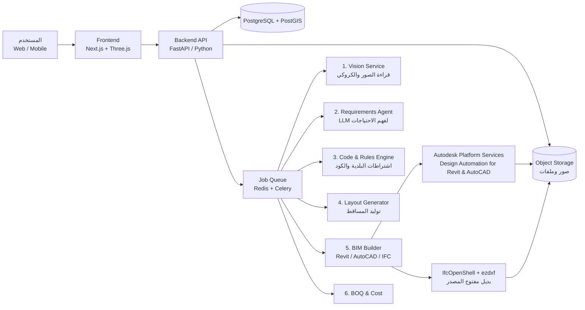

# خطة مشروع: منصة التصميم الهندسي بالذكاء الاصطناعي
### AI Design Platform — من صورة أو مقاسات إلى مشروع Revit و AutoCAD كامل

> 📋 خطوات التنفيذ التفصيلية والأدوات: [EXECUTION_STEPS.md](EXECUTION_STEPS.md)

> **الفكرة في سطر واحد:** المستخدم يرفع صور أو كروكي أو مقاسات لقطعة أرض أو وحدة سكنية/تجارية، ويكتب احتياجاته، والمنصة تولّد له تلقائياً مشروعاً معمارياً مفصلاً (نموذج Revit ‏RVT + لوحات AutoCAD ‏DWG + PDF + جداول كميات + تكلفة تقديرية)، يراجعه مهندس مرخّص قبل التسليم.

---

## 1. نطاق المنتج (Scope)

### 1.1 أنواع المدخلات
| النوع | أمثلة | طريقة المعالجة |
|---|---|---|
| مقاسات يدوية | طول × عرض، أطوال الأضلاع، الزوايا، الارتدادات | نموذج إدخال ذكي + رسم مضلّع تفاعلي على الشاشة |
| صورة كروكي / صك / رخصة | صورة الكروكي من البلدية، صورة الصك | Vision AI لاستخراج الأضلاع والمساحة ورقم القطعة والشوارع المحيطة |
| موقع على الخريطة | تحديد القطعة على Google Maps / خرائط بلدي | رسم حدود القطعة وجلب عرض الشوارع والاتجاه (الشمال) |
| صور للوحدة القائمة | صور غرف شقة أو محل | تقدير أبعاد تقريبي + طلب مقاس مرجعي واحد للمعايرة |
| مسح LiDAR بالموبايل | iPhone Pro (Apple RoomPlan) | استخراج حوائط وأبواب وشبابيك بدقة ±2–5 سم → Scan-to-BIM |
| ملف موجود | DWG / DXF / PDF مخطط قديم | قراءة الخطوط والطبقات وتحويلها لعناصر BIM |

### 1.2 أنواع المشاريع (بالترتيب حسب الأولوية)
1. **فيلا سكنية / دور سكني** على أرض فضاء (الأكثر طلباً، والأسهل قواعدياً).
2. **عمارة سكنية** (شقق متكررة على أدوار).
3. **تعديل / تشطيب وحدة قائمة** (شقة أو محل) — Interior layout.
4. **مبنى تجاري / معارض + مكاتب**.
5. لاحقاً: مستودعات وورش صناعية (مناسبة لمشاريع المدن الصناعية).

### 1.3 المخرجات
- **نموذج Revit (‎.rvt)** بمستوى تفاصيل LOD 200–300: حوائط، أرضيات، أسقف، أبواب، شبابيك، سلالم، غرف بأسماء ومساحات، أعمدة وكمرات مبدئية.
- **لوحات AutoCAD (‎.dwg)** بطبقات قياسية: مسقط الموقع، المساقط الأفقية لكل دور، الواجهات الأربع، قطاعان، مسقط السقف، جدول الأبواب والشبابيك.
- **ملف PDF** بلوحات مرقمة ومُعنونة (Title block باسم المكتب والمالك).
- **IFC** (معيار مفتوح) للتوافق مع أي برنامج آخر.
- **جدول كميات (BOQ)** مبدئي Excel: خرسانة، طوب، لياسة، بلاط، دهانات…
- **تكلفة تقديرية** حسب أسعار السوق المحلية.
- **صور 3D وجولة افتراضية** في المتصفح.

---

## 2. رحلة المستخدم (User Journey)

```
1. تسجيل → 2. مشروع جديد → 3. رفع/إدخال بيانات الأرض أو الوحدة
→ 4. استبيان الاحتياجات (محادثة مع مساعد AI) → 5. عرض 3–5 بدائل تصميم
→ 6. تعديل تفاعلي ("كبّر المطبخ"، "انقل الدرج") → 7. اختيار التصميم النهائي
→ 8. توليد RVT + DWG + PDF + BOQ → 9. مراجعة مهندس مرخّص (اختياري/إلزامي حسب الباقة)
→ 10. تحميل الملفات + طلب خدمات إضافية (إنشائي، كهروميكانيك، رخصة بناء)
```

**أمثلة لأسئلة الاستبيان:** عدد الأدوار، عدد غرف النوم، مجلس رجال/نساء منفصل، غرفة خادمة/سائق، مدخل منفصل للضيوف، ملحق علوي، مسبح، موقف سيارات، نمط الواجهة (حديث/نجدي/كلاسيك)، الميزانية.

---

## 3. المعمارية التقنية (System Architecture)



### 3.1 الطبقات بالتفصيل

| الطبقة | التقنية المقترحة | ملاحظات |
|---|---|---|
| واجهة الويب | Next.js + TypeScript + Tailwind، دعم RTL كامل | |
| عارض 2D/3D | Three.js / IFC.js (That Open Engine)، و Autodesk Viewer لملفات RVT | |
| تطبيق الموبايل | React Native / Flutter + وحدة Swift لـ RoomPlan (LiDAR) | المرحلة 2 |
| Backend | Python FastAPI | Python لأن مكتبات الهندسة والـ AI كلها Python |
| قاعدة البيانات | PostgreSQL + PostGIS (للحدود الجغرافية للأراضي) | |
| الطوابير | Redis + Celery (أو Temporal للعمليات الطويلة) | توليد Revit قد يأخذ 2–10 دقائق |
| التخزين | S3 / Azure Blob | |
| الاستضافة | AWS أو Azure (منطقة الشرق الأوسط — مهم لسيادة البيانات في السعودية) | |
| المصادقة | Auth0 / Keycloak + تسجيل برقم الجوال (OTP) | |
| الدفع | Moyasar / HyperPay / Tap (مدى، Apple Pay) | |

---

## 4. محرك الذكاء الاصطناعي (قلب المنصة)

> **مبدأ أساسي:** الذكاء الاصطناعي التوليدي **لا يرسم الخطوط مباشرة**. هو يفهم المدخلات ويقترح، بينما **محرك هندسي حتمي (Deterministic)** يولّد الهندسة الدقيقة ويتحقق من الاشتراطات. هذا هو الفرق بين منصة تنتج رسومات "شكلها حلو" ومنصة تنتج رسومات قابلة للتنفيذ.

### 4.1 الوحدة 1 — قراءة المدخلات (Vision)
- **نموذج Vision-LLM** (مثل Claude) لقراءة الكروكي والصك: استخراج أطوال الأضلاع، المساحة، أسماء/عروض الشوارع، رقم القطعة → JSON منظم.
- **تحقق رياضي:** إغلاق المضلّع، مطابقة المساحة المحسوبة مع المكتوبة (فرق > 1% = تنبيه للمستخدم).
- **صور الوحدات القائمة:** نماذج Segmentation (مثل SAM) + Depth estimation لتقدير الحوائط والفتحات، **مع إلزام المستخدم بمقاس مرجعي واحد** على الأقل للمعايرة. الصور وحدها لا تعطي دقة إنشائية — يجب توضيح ذلك للمستخدم.
- **LiDAR:** RoomPlan يعطي نموذج غرف جاهز (USDZ/JSON) → تحويل مباشر لحوائط وفتحات.
- **DWG/PDF قديم:** ezdxf لقراءة DXF، ونموذج تعرّف على الرموز المعمارية للـ PDF الممسوح.

### 4.2 الوحدة 2 — فهم الاحتياجات (Requirements Agent)
- محادثة بالعربي (والعامية) مع LLM تحوّل كلام المستخدم إلى **برنامج فراغات (Space Program)** منظم:
```json
{
  "floors": 2, "roof_annex": true,
  "spaces": [
    {"type": "majlis_men", "min_area": 30, "floor": 0, "private_entrance": true},
    {"type": "master_bedroom", "min_area": 25, "floor": 1, "ensuite": true},
    {"type": "kitchen", "min_area": 16, "floor": 0, "adjacent_to": ["dining", "service_entrance"]}
  ],
  "style": "modern_najdi", "budget_sar": 1200000
}
```
- مكتبة معايير جاهزة لكل فراغ (أقل مساحة، أقل عرض، علاقات التجاور، الخصوصية، الإضاءة الطبيعية).

### 4.3 الوحدة 3 — محرك الاشتراطات (Rules Engine)
- قاعدة قواعد قابلة للتعديل لكل مدينة/مخطط:
  - **اشتراطات البلدية:** الارتدادات (أمامي/جانبي/خلفي)، نسبة البناء، عدد الأدوار، الملحق العلوي (نسبة من الدور الأرضي)، الأسوار، المواقف.
  - **كود البناء السعودي (SBC):** أقل أبعاد الغرف، ارتفاعات الأسقف، الدرج (القائمة والنائمة)، مخارج الطوارئ، التهوية والإنارة، الوصولية.
  - **(للمستخدمين في مصر):** قانون البناء الموحد 119/2008 واشتراطات الأحياء — كوحدة قواعد منفصلة.
- يُكتب كقواعد صريحة (Python / JSON rules) **وليس** كتعليمات للـ LLM، حتى تكون النتيجة قابلة للتدقيق.
- ناتج الوحدة: **"المغلف المسموح للبناء" (Buildable Envelope)** + تقرير مطابقة لكل تصميم.

### 4.4 الوحدة 4 — توليد المساقط (Layout Generation)
نهج هجين على 3 مراحل:
1. **توليد مخطط العلاقات (Bubble Diagram):** Graph بين الفراغات (تجاور، خصوصية عام/خاص، نطاق خدمة) — من LLM + قواعد.
2. **توزيع الفراغات داخل المغلف:**
   - **الإصدار الأول (MVP):** مكتبة **قوالب مصممة مسبقاً** (Parametric templates) لأشهر مقاسات الأراضي (مثلاً 15×20، 20×25، 25×30، 30×30) تتمدد وتنكمش بارامترياً. هذا أسرع وأكثر موثوقية للإطلاق.
   - **الإصدار الثاني:** محرك تحسين (Constraint solver / Genetic algorithm — مثل OR-Tools) يولّد عشرات البدائل ويقيّمها.
   - **الإصدار الثالث:** نموذج توليدي مدرّب (Graph-to-Plan, مثل أبحاث HouseGAN++/Graph2Plan) على قاعدة بيانات مخططات المكتب نفسه.
3. **التقييم والترتيب:** درجة لكل بديل (كفاءة المساحة %، مطابقة الاشتراطات، الإضاءة، طول الممرات، تكلفة تقديرية) → عرض أفضل 3–5 للمستخدم.

- **التعديل بالكلام:** "كبّر الصالة مترين" → LLM يحوّلها لعملية على النموذج البارامتري → إعادة التحقق من الاشتراطات تلقائياً.

### 4.5 الوحدة 5 — بناء BIM (Revit & AutoCAD)
**النموذج الوسيط:** كل التصميمات تُحفظ داخلياً بصيغة JSON موحدة (Building Schema) — مستويات، حوائط (خط محور + سماكة + نوع)، فتحات، غرف، سلالم، أعمدة. ثم تُصدَّر لكل الصيغ من نفس المصدر:

| المخرج | التقنية | التفاصيل |
|---|---|---|
| **Revit RVT** | **Autodesk Platform Services — Design Automation API for Revit** | Add-in مكتوب بـ C# (Revit API) يقرأ JSON وينشئ: Levels, Grids, Walls, Floors, Roofs, Doors, Windows, Stairs, Rooms, Columns, Beams، ثم Views و Sheets و Schedules و Dimensions و Tags. يعمل Revit سحابياً بدون واجهة، الدفع بـ Cloud Credits. |
| **قالب Revit (Template .rte)** | يُعدّ مرة واحدة يدوياً | Families عربية (أبواب/شبابيك/أثاث سعودي)، أنواع حوائط (بلوك 20 سم، عزل…)، Title block، أنماط الأبعاد، View templates. **جودة هذا القالب = جودة المخرج النهائي.** |
| **AutoCAD DWG** | (أ) تصدير مباشر من Revit عبر Design Automation (أفضل جودة، طبقات منظمة)، (ب) Design Automation for AutoCAD لتنسيق اللوحات | معيار طبقات موحد (A-WALL, A-DOOR, A-GLAZ, A-DIMS, A-ANNO…) |
| **DXF / IFC (بديل مفتوح)** | ezdxf + IfcOpenShell (Python) | يقلل الاعتماد على Autodesk وتكلفة الـ credits، ويستخدم للمعاينة السريعة قبل التوليد النهائي |
| **PDF** | طباعة الـ Sheets من Revit | |
| **عارض الويب** | تحويل RVT عبر APS Model Derivative → Autodesk Viewer | |

### 4.6 الوحدة 6 — الكميات والتكلفة
- استخراج الكميات من جداول Revit (Schedules) أو مباشرة من النموذج الوسيط.
- قاعدة أسعار وحدات قابلة للتحديث (حسب المدينة)، وربط ببنود BOQ قياسية.
- إخراج Excel بنفس هيكلة جداول الكميات المستخدمة في مشاريع المستودع.

### 4.7 المراجعة البشرية (Human-in-the-loop) — إلزامية
- لوحة تحكم للمهندسين: قائمة مشاريع للمراجعة، أدوات تعليق على اللوحات، إمكانية فتح RVT وتعديله ثم رفعه.
- **لا تُسلَّم أي رسومات للترخيص أو التنفيذ إلا بعد اعتماد مهندس/مكتب هندسي معتمد** (هيئة المهندسين السعودية / نقابة المهندسين). المنصة تقدم "مسودة تصميم" والمكتب يختم.
- كل تعديل بشري يُحفظ كبيانات تدريب لتحسين المحرك.

---

## 5. نموذج البيانات (مختصر)

```
users(id, name, phone, role[client|engineer|admin], org_id)
organizations(id, name, license_no, logo)            -- المكاتب الهندسية
projects(id, owner_id, type[villa|apartment_bldg|unit_fitout|commercial], city, status)
sites(id, project_id, boundary GEOGRAPHY, area_m2, north_angle, streets JSONB, source[manual|sketch|map|lidar])
uploads(id, project_id, kind[photo|sketch|deed|dwg|lidar], url, extracted JSONB)
requirements(id, project_id, space_program JSONB, style, budget)
rule_sets(id, city, plan_code, rules JSONB, version)
design_options(id, project_id, building_schema JSONB, score JSONB, compliance_report JSONB, preview_url)
generation_jobs(id, option_id, target[rvt|dwg|ifc|pdf|boq], status, credits_used, output_url, log)
reviews(id, option_id, engineer_id, status, comments JSONB, approved_at)
orders(id, project_id, package, amount, payment_status)
```

## 6. واجهات API الرئيسية

```
POST /projects                         إنشاء مشروع
POST /projects/{id}/uploads            رفع صورة/كروكي/ملف
POST /projects/{id}/site/extract       استخراج حدود الأرض من الصورة (AI)
PUT  /projects/{id}/site               تأكيد/تعديل الحدود يدوياً
POST /projects/{id}/requirements/chat  محادثة الاحتياجات
POST /projects/{id}/options/generate   توليد البدائل
POST /options/{id}/edit                تعديل بالكلام أو بالسحب
POST /options/{id}/export?format=rvt|dwg|ifc|pdf|boq
GET  /jobs/{id}                        حالة التوليد
POST /options/{id}/review              مراجعة المهندس واعتماده
```

---

## 7. خطة التنفيذ الزمنية

| المرحلة | المدة | المخرجات |
|---|---|---|
| **0. التحضير والتحقق** | شهر 1 | دراسة السوق، مقابلة 20 مالك أرض و5 مكاتب هندسية، اختيار مدينة واحدة للبداية (مثلاً الرياض)، تجميع اشتراطات البلدية، توقيع اتفاقية Autodesk Developer/APS |
| **1. النموذج التجريبي (PoC)** | شهر 2–3 | إدخال مقاسات يدوي → قالب بارامتري لفيلا دورين → توليد RVT + DWG حقيقي عبر Design Automation. **هدف المرحلة: إثبات أن السلسلة تعمل من أولها لآخرها.** |
| **2. MVP** | شهر 4–6 | قراءة الكروكي بالـ AI، استبيان المحادثة، 15–20 قالب فيلا، محرك اشتراطات لمدينة واحدة، عارض 3D، لوحة مراجعة المهندس، الدفع. **إطلاق تجريبي مغلق مع 50 مستخدم.** |
| **3. الإصدار 1.0** | شهر 7–9 | محرك تحسين يولّد بدائل غير مقيدة بالقوالب، تعديل بالكلام، BOQ وتكلفة، عمارات سكنية، مدن إضافية، إطلاق عام |
| **4. التوسع** | شهر 10–15 | تطبيق موبايل + LiDAR لتعديل الوحدات القائمة، المباني التجارية، تصميم إنشائي مبدئي (أعمدة/قواعد)، كهروميكانيك مبدئي، API للمكاتب الهندسية (White-label) |
| **5. النموذج الخاص** | شهر 15+ | تدريب نموذج توليد مساقط على بيانات المنصة المعتمدة من المهندسين |

---

## 8. الفريق المطلوب

| الدور | العدد | المرحلة |
|---|---|---|
| مدير منتج (خلفية هندسية معمارية) | 1 | من البداية |
| مهندس معماري BIM (خبير Revit Families/Templates) | 1–2 | من البداية — **أهم دور في المشروع** |
| مطور Revit API / C# (Design Automation) | 1 | من البداية |
| مطور Backend Python + هندسة حسابية (Computational geometry) | 1–2 | من البداية |
| مهندس AI/ML (Vision + LLM + Optimization) | 1 | من المرحلة 1 |
| مطور Frontend (React + Three.js) | 1 | من المرحلة 1 |
| مصمم UI/UX | 1 (جزئي) | المرحلة 2 |
| مهندسون مراجعون (معماري/إنشائي) | شراكة مع مكتب معتمد | المرحلة 2 |
| DevOps | جزئي | المرحلة 2 |

---

## 9. الميزانية التقديرية (تقريبية — للتخطيط فقط)

| البند | حتى الـ MVP (6 أشهر) | سنة كاملة |
|---|---|---|
| الرواتب (6–8 أفراد) | 600–900 ألف ريال | 1.5–2.2 مليون ريال |
| السحابة والاستضافة | 20–40 ألف ريال | 80–150 ألف ريال |
| Autodesk APS (Design Automation credits) | 10–30 ألف ريال | حسب الاستخدام (تكلفة متغيرة لكل مشروع) |
| تراخيص Revit/AutoCAD للفريق | 30–50 ألف ريال | 60–90 ألف ريال |
| استهلاك نماذج الذكاء الاصطناعي (LLM/Vision APIs) | 10–20 ألف ريال | حسب الاستخدام |
| قانوني وتسجيل وتسويق إطلاق | 50–100 ألف ريال | 200–400 ألف ريال |

> الأرقام تقديرية وتختلف كثيراً حسب الدولة وتكلفة الفريق. لو الفريق في مصر، تنخفض الرواتب بشكل كبير.

## 10. نموذج الربح (Business Model)

| الباقة | المحتوى | سعر مقترح |
|---|---|---|
| **مجانية** | إدخال الأرض + 3 بدائل مساقط 2D + عرض 3D (بدون تحميل) | 0 |
| **مسودة** | تحميل DWG + PDF للتصميم المختار | 500–1,000 ريال |
| **احترافي** | RVT + DWG + PDF + IFC + BOQ وتكلفة | 2,000–4,000 ريال |
| **معتمد** | كل ما سبق + مراجعة واعتماد مكتب هندسي + مخططات الرخصة | حسب المساحة (عمولة من المكتب) |
| **للمكاتب (SaaS)** | اشتراك شهري للمكاتب الهندسية لتسريع عملها | 1,500–5,000 ريال/شهر |

**الميزة التنافسية:** مكتب هندسي تقليدي يأخذ 2–6 أسابيع للمسودة الأولى؛ المنصة تعطي البدائل في دقائق والملفات الكاملة في ساعات، بتكلفة أقل كثيراً.

---

## 11. المخاطر وطرق التعامل معها

| الخطر | الأثر | المعالجة |
|---|---|---|
| دقة الصور غير كافية لرسومات تنفيذية | عالي | إلزام مقاس مرجعي، دعم LiDAR، وتوضيح أن مخرج الصور "مسودة" حتى التحقق الميداني |
| تصميمات غير منطقية من الـ AI | عالي | محرك قواعد حتمي + قوالب في البداية + مراجعة مهندس إلزامية |
| المسؤولية القانونية عن التصميم | عالي | المنصة أداة مساعدة؛ الاعتماد والختم من مكتب مرخّص؛ شروط استخدام واضحة |
| اختلاف الاشتراطات بين المدن والمخططات | متوسط | Rules engine قابل للتحرير من لوحة إدارة، والبدء بمدينة واحدة |
| تكلفة Autodesk والاعتماد عليها | متوسط | المعاينة بالـ IFC/DXF مفتوح المصدر، والتوليد بـ Revit فقط عند الدفع |
| جودة Revit families والقالب | متوسط | استثمار مبكر في مهندس BIM وبناء مكتبة عائلات عربية |
| حماية بيانات العملاء (صكوك، مواقع) | متوسط | استضافة داخل المنطقة، تشفير، الالتزام بنظام حماية البيانات الشخصية (PDPL) |
| المنافسون (Finch, Maket.ai, TestFit…) | متوسط | التخصص في السوق العربي: اشتراطات محلية، فراغات سعودية (مجالس، ملاحق)، لغة عربية، ربط بالرخص |

## 12. مؤشرات النجاح (KPIs)

- زمن توليد البدائل < 60 ثانية، وزمن توليد RVT + DWG < 10 دقائق.
- ≥ 90% من التصميمات المولدة تجتاز محرك الاشتراطات بدون تعديل.
- ≤ 20% نسبة التعديلات اللي يحتاجها المهندس المراجع (تقل مع الوقت).
- نسبة التحويل من المجاني للمدفوع ≥ 5%.
- رضا المستخدم (NPS) ≥ 40.

---

## 13. الخطوات العملية التالية (أول أسبوعين)

1. **تحديد السوق الأول:** مدينة واحدة + نوع واحد (فيلا سكنية دورين + ملحق).
2. **تجميع اشتراطات** تلك المدينة في ملف قواعد واحد.
3. **تجهيز 5 مخططات فيلا حقيقية** (من أرشيف مكتب) لتحويلها إلى قوالب بارامترية.
4. **فتح حساب Autodesk Platform Services** وتجربة Design Automation for Revit بمثال "Hello Wall".
5. **بناء PoC بسيط:** JSON لأرض 20×25 → Revit add-in ينشئ حوائط وأبواب وغرف → تصدير DWG و PDF.
6. **مقابلة 3–5 مكاتب هندسية** للاتفاق على شراكة المراجعة والاعتماد.

---

### ملحق: هيكل المستودع المقترح للكود

```
ai-design-platform/
├── apps/
│   ├── web/                  # Next.js frontend
│   └── mobile/               # React Native + RoomPlan
├── services/
│   ├── api/                  # FastAPI
│   ├── vision/               # قراءة الصور والكروكي
│   ├── requirements-agent/   # LLM للاحتياجات
│   ├── rules-engine/         # الاشتراطات والكود
│   ├── layout-generator/     # توليد المساقط
│   ├── bim-builder/
│   │   ├── revit-addin/      # C# Revit API (Design Automation bundle)
│   │   ├── autocad-scripts/  # AutoCAD Design Automation
│   │   └── open-export/      # IfcOpenShell + ezdxf
│   └── boq-cost/
├── templates/
│   ├── revit/                # .rte + families
│   └── layouts/              # القوالب البارامترية للفلل
├── rules/                    # ملفات الاشتراطات لكل مدينة
└── docs/
```
